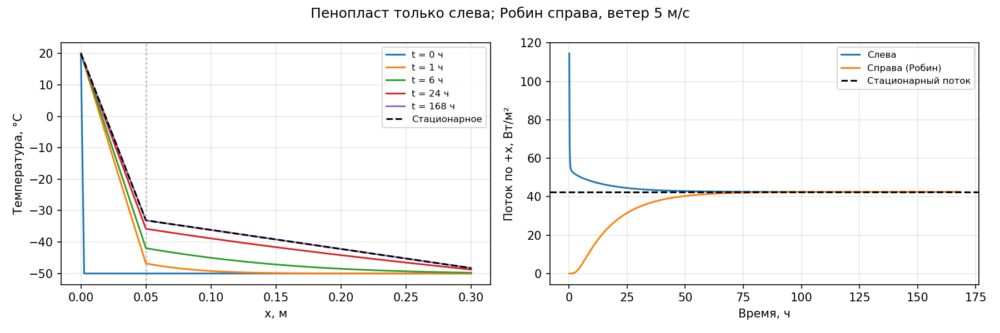

# Лабораторная работа 4, вариант 5

Стенка слева направо: **пенопласт — кирпич**. Справа задано условие Робина.

[Исходный код](../../laba4-5.py) · [Графики](heat.png) · [Температуры](temperature.csv) · [Потоки](flux.csv) · [Массивы расчёта](heat.npz)

## Постановка задачи

Решается одномерное уравнение теплопроводности `ρc ∂T/∂t = ∂/∂x(λ ∂T/∂x)` при постоянных свойствах каждого слоя. На стыках непрерывны температура и тепловой поток. Поток `q = −λ ∂T/∂x` положителен слева направо; расчёт ведётся на 1 м² стенки.

| Слой слева направо | Толщина, м | λ, Вт/(м·К) | ρ, кг/м³ | c, Дж/(кг·К) |
|---|---:|---:|---:|---:|
| 1. Пенопласт | 0.05 | 0.04 | 30 | 1400 |
| 2. Кирпич | 0.25 | 0.7 | 1800 | 840 |

Свойства материалов — учебные параметры, принятые в скрипте. В этом варианте один слой пенопласта, пенофола нет.

- Слева: `T(0,t) = 20 °C`.
- Начальная температура всех узлов, кроме заданной левой границы: `−50 °C`.
- Справа: `−λ ∂T/∂x = hᵥ(Tпов − Tвозд)`, `Tвозд = −50 °C`.
- Скорость ветра в учебном сценарии: `v = 5 м/с`; коэффициент теплоотдачи в модели: `hᵥ = 5.7 + 3.8v = 24.7 Вт/(м²·К)`.
- Общая толщина: `0.3 м`; длительность: `7 суток`; шаг времени: `600 с`.

## Метод расчёта

Неявная схема по времени и баланс тепла по внутренним контрольным объёмам. На каждый слой приходится 20 отрезков: всего 40 отрезков и 41 узел. Проводимость отрезка равна `G = λ/Δx`; теплоёмкости соседних полуотрезков суммируются в узле. На каждом шаге трёхдиагональная система решается методом прогонки. Граничные узлы собственной теплоёмкости не имеют.

Правая температура исключается через последовательное соединение последнего отрезка и теплоотдачи: `Gправ = 1/(1/Gпосл + 1/hᵥ)`. После прогонки она восстанавливается из равенства проводимого и конвективного потоков.

## Стационарное решение

Сопротивление слоёв: `Rсл = Σ(d/λ) = 1.607142857 м²·К/Вт`.
Сопротивление теплоотдачи: `1/hᵥ = 0.040485830 м²·К/Вт`; полное сопротивление: `R = 1.647628687 м²·К/Вт`.

Стационарный поток: `qст = (20 − (−50))/(Rсл + 1/hᵥ) = 42.485301 Вт/м²`.

| Положение | x, м | Стационарная температура, °C |
|---|---:|---:|
| Левая поверхность | 0 | 20.000000 |
| Стык пенопласт / кирпич | 0.05 | -33.106626 |
| Правая поверхность | 0.3 | -48.279947 |

## Изменение во времени

| Время, ч | T стыка 1, °C | T справа, °C | q слева, Вт/м² | q справа, Вт/м² |
|---:|---:|---:|---:|---:|
| 1 | -46.832171 | -49.999632 | 53.778851 | 0.009100 |
| 6 | -41.956668 | -49.776549 | 49.627437 | 5.519233 |
| 24 | -35.789522 | -48.754623 | 44.648869 | 30.760808 |
| 168 | -33.106838 | -48.279985 | 42.485472 | 42.484371 |

Через 7 суток максимальное по узлам отклонение от стационарного профиля составляет `0.000216112 °C`. Разность входящего и выходящего потоков равна `0.00110146 Вт/м²` и соответствует накоплению тепла внутри стенки.

## Проверки

- Максимальная нормированная невязка баланса энергии: `3.335e-09` при допуске `1e-7`. Нормировка: `|ΔE − Δt(qслева − qсправа)| / max(|ΔE|, |Δt(qслева − qсправа)|, 1 Дж/м²)`.
- Расхождение аналитического стационарного профиля с независимым решением линейной системы: `1.137e-13 °C` при допуске `1e-8 °C`.
- Температура во всём расчёте остаётся в пределах от −50 до 20 °C с допуском `1e-8 °C`.
- Максимальная невязка условия Робина: `6.253e-13 Вт/м²` при допуске `1e-8 Вт/м²`.

Все перечисленные проверки выполнены по сохранённому `heat.npz`.

## Вывод

К концу 7 суток профиль практически стационарен: максимальное отклонение — 0.000216 °C. Робин справа снижает стационарный поток с 43.555556 до 42.485301 Вт/м², на 2.46%. Стационарный поток совпадает с вариантом 6, но температура стыка здесь отрицательная: -33.106626 °C. Наружная поверхность в стационаре теплее воздуха на 1.720053 °C.



## Запуск

Из корня проекта при установленных NumPy и Matplotlib:

```bash
python3 AppliedMathematics/laba4/laba4-5.py
```

Скрипт сохраняет результаты рядом с этой сводкой. Числа в сводке относятся к параметрам, указанным выше; при изменении скрипта сводку нужно обновить.
